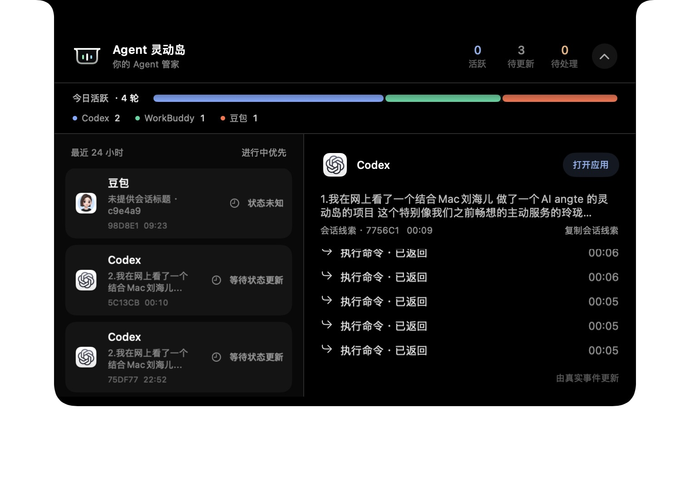

# Agent 灵动岛 / Agent Dynamic Island

> GitHub Alpha：面向愿意自己构建、理解本地 Hook 和 macOS 权限边界的早期体验者。当前没有 Developer ID 公证包，也不承诺所有 Agent / Mac 机型开箱即用。

你的 Agent 管家。运行在 macOS 刘海区域的本地动态状态层：空闲时归入物理刘海，事件到达时保持刘海高度并横向展开，连续悬停 0.2 秒查看详情。状态来自真实事件，不推测进度。默认只观察状态；Claude Code 可显式开启经参数审阅的单次审批，其余待确认操作回原应用处理。不在岛上停止或重试任务。

内置四个一级 Agent 身份：

- `Codex`：终端 / 代码执行
- `Claude`：长上下文分析与代码协作
- `豆包`：中文内容与多模态任务
- `Work Buddy`：工作上下文、提醒与跨任务接续

图标从本机安装的应用读取，不另行仿制厂商 Logo；未安装时明确使用通用占位。视觉、交互与功能有独立验收 Agent，不作为 HUD 内第五个身份。

产品介绍海报：[三张真实界面合成海报](docs/POSTERS.md)。

## 真实产品界面

以下三张均来自 2026-10-08 当前运行版本，不是生成图。窗口截图中的透明区域显示为白色，图片只做裁剪。

### 小态 · 持续状态

收窄显示 Agent 身份与活动提示。截图取自当前任务数据，不把待更新任务称为正在执行。


### 中态 · 横向展开

使用设置中的“预览中态”截取真实界面，图中“中态预览”不是任务事件；没有创建或修改真实任务。


### Hover 展开态 · 任务总览

2026-10-08 从当前运行版本重新截取。展示最近 24 小时的任务、今日活跃轮次、会话线索与已返回步骤；截图中的状态是截取当时的状态，不代表实时进度。透明窗口区域在窗口截图中显示为白色。



## 顶部灵动岛的三种状态

灵动岛只保留三种核心视觉层级：持续执行时的最小态、事件到达时的中态，以及连续悬停 0.2 秒后的 Hover 展开态。上面展示三种界面的当前版本窗口截图；中态使用内置尺寸预览触发，非真实任务事件。

- **最小态 · 持续执行**：任务继续运行时收窄回接近物理刘海，只保留必要的 Agent 身份和动态活动提示。
- **中态 · 新事件**：任务开始、需要关注或结束时横向展开，短暂呈现关键状态；长任务随后回到最小态继续保留。
- **Hover 展开态 · 查看详情**：鼠标在顶部连续停留 0.2 秒后展开详情，展示最近 24 小时任务记录；移开后恢复对应状态。

完整的状态规则见：[三种核心状态](docs/STATE_SHOWCASE.md)。

## 运行

```bash
cd linglongtai-hud
./script/build_and_run.sh
```

开发验收预览（不读取或覆盖个人任务数据）：

```bash
./script/build_and_run.sh --qa-empty
./script/build_and_run.sh --qa-demo
```

独立状态回归检查：

```bash
swift build --build-system swiftbuild --product linglongtai-acceptance
.build/out/Products/Debug/linglongtai-acceptance
```

如果本机 Command Line Tools 与 Swift 编译器版本不一致，SwiftPM 会在编译阶段停止；此时需要在 Xcode / Command Line Tools 中选择同一套版本后重新运行上面的命令。启动后可从菜单栏灵动岛图标打开「灵动岛设置…」。

应用会构建到 `dist/Agent 灵动岛.app`，启动后显示顶部灵动岛，并在菜单栏保留一个灵动岛入口。首次启动默认不注入演示任务；可以从菜单栏打开「灵动岛设置…」，在「本地任务数据」中载入演示任务。

## GitHub Alpha 快速开始

1. macOS 13 或更高版本、Apple 芯片（当前候选包未验证 Intel）；安装匹配版本的 Xcode Command Line Tools。
2. 克隆仓库后运行 `./script/build_and_run.sh`。脚本只构建并启动本地 App，不上传数据。
3. 从菜单栏打开「接入与验证…」，只勾选你真正使用的 Agent。向导会先展示配置路径，用户确认后才写入，并保留本地备份。
4. 在原应用发起一轮真实任务，回到灵动岛确认收到状态。看到“已安装”不等于连接健康；Claude Code 需要单独验证，Claude Chat 和豆包属于实验性/只读边界。

Alpha 反馈请附 macOS 版本、芯片架构、Agent 应用版本和脱敏后的状态描述；不要上传 `events.jsonl`、`hook-turns.json`、会话标题、提示词、工具参数、日志原文或任何凭据。发布前请先阅读 [隐私说明](docs/PRIVACY.md)、[安全反馈](SECURITY.md) 和 [Alpha 发布清单](docs/ALPHA_RELEASE.md)。

## 本地 Agent 接入

现已提供 Codex、Claude Code、WorkBuddy 的生命周期 Hook；Claude Chat 的辅助功能只读观察仍属于实验性能力，未列入 Alpha 的兼容保证。豆包只读本地 Agent 模式轨迹，普通聊天不可见。接入只记录开始、等待、执行、结束和失败等元数据，不保存输入内容、工具内容、聊天正文、聊天文件路径或凭据，不推测百分比。“收到过回调”只证明历史接入，不保证当前连接健康。打开应用不保证定位到原会话。

```bash
swift build --build-system swiftbuild --product linglongtaictl
python3 script/install_hooks.py --binary .build/out/Products/Debug/linglongtaictl
python3 script/install_hooks.py --binary .build/out/Products/Debug/linglongtaictl --apply
```

Alpha 用户优先从菜单栏打开“接入与验证…”。向导只在用户确认后合并所选配置，使用带内容指纹的桥接文件，旧配置先备份；不会修改信任策略、不会提交批准决定、不会启动任务。命令行安装器仍保留给开发者使用。

安装器保留已有设置并备份，合并到 `~/.codex/hooks.json`、`~/.claude/settings.json`、`~/.workbuddy/settings.json`。稳定桥接程序位于应用支持目录的 `bin/linglongtaictl`。不会修改 Codex 的信任策略；需要时在官方 `/hooks` 页面审阅。卸载仅移除本项目命令：安装命令追加 `--uninstall`。

2026-10-08 实机结果：Codex、Claude Code、WorkBuddy 均已收到真实生命周期事件并正常完成。Claude Code 历史上曾被账户/接口配置问题阻挡（401，非产品缺陷），当前已完成 UserPromptSubmit → PreToolUse → PostToolUse → Stop 全链路验证。Claude Chat 观察代码存在但仍需单独的辅助功能权限、窗口变化和误报实测，不作为 Alpha 的正常路径承诺。

以下 CLI 为自定义事件接入工具，手工调用不等于对应厂商已经接入：

构建 CLI：

```bash
swift build --build-system swiftbuild --product linglongtaictl
CTL="$(swift build --build-system swiftbuild --show-bin-path)/linglongtaictl"
```

创建任务并拿到 UUID：

```bash
TASK_ID="$($CTL start --agent Claude --title "整理本周素材" --model "Claude Code")"
```

四个 Agent 都可以这样启动：

```bash
$CTL start --agent codex --title "检查构建"
$CTL start --agent claude --title "整理研究材料"
$CTL start --agent doubao --title "生成中文摘要"
$CTL start --agent work-buddy --title "同步今日工作上下文"
```

更新状态：

```bash
$CTL update --id "$TASK_ID" --progress 0.55 --detail "正在整理第 3 个目录"
$CTL wait --id "$TASK_ID" --detail "需要用户确认后继续"
$CTL finish --id "$TASK_ID"
```

事件写入：

`~/Library/Application Support/LinglongtaiHUD/events.jsonl`

HUD 提供“打开应用”，不在本地假装停止、重试或任务完成。`commands.jsonl` 是旧命令请求协议，不代表厂商执行成功，也不由当前界面调用。

## 审批与权限检查

默认接入只观察状态，Codex、WorkBuddy、豆包不提供岛内批准回写。Claude Code 可显式开启单次审批中继：只有真实、存活、未过期且绑定当前任务的请求才显示“批准请求…”，核对完整参数后选择“仅允许这一次”或“拒绝本次”。Claude Chat 的普通通知不可回写。

```bash
python3 script/install_hooks.py --binary .build/out/Products/Debug/linglongtaictl --apply
```

- 显式开启：`python3 script/install_hooks.py --binary 'dist/Agent 灵动岛.app/Contents/Helpers/linglongtaictl' --providers claude --approval-relay --apply`。配置先备份，只使用已签名桥接程序，其他 provider 配置不变。
- 完整工具参数只在本机私有目录暂存，敏感或过大参数回退原应用，不进入事件日志。仅回写单次 allow/deny，不写长期权限。
- 45 秒无决定、HUD 隐藏/退出或不可用时回退原应用。真实会话是否加载新 Hook 需以实际事件确认；fixture 不等于端到端验证。
- 原生“安装接入”当前仍安装观察模式，重新安装 Claude 后如需快捷审批，须再次显式执行上述选项。

协议依据：[Claude Code 官方 Hooks 文档](https://code.claude.com/docs/en/hooks#permissionrequest-decision-control)。该回写协议不泛化到其他应用或历史版本。

## 当前边界

当前能力与待验证项以 [0.3.1 发布准备](docs/RELEASE_READINESS.md) 和 [Claude 快捷审批修订](docs/CLAUDE_APPROVAL_FIX_20261008.md) 为准。旧三家通用批准桥已失效，目前只恢复 Claude Code 显式开启的单次中继。

- `20261006.7`：左侧无额外边框；多任务图标叠放，当前展示任务在最前。Hover保留最近24小时的进行中与已结束记录，状态文字及弱化样式区分；历史不计运行数量、不让空闲岛常驻。相关Store回归与构建通过，小态实机可见；完整列表视觉验收受锁屏中断。
- `20261011.1`：修正任务列表分组排序：排序先按最终展示分组，再按该任务最近真实更新时间倒序；已结束记录按结束先后排列，豆包的未知/不再跟踪记录不会再错误挤入进行中优先级。新增对应 Store 回归用例。源码构建与 239 项隔离 Store 回归通过。
- `20261006.6`：补上处理中小态右侧动态指示。真实 running 时显示三段错峰呼吸条，不代表百分比；等待、批准、过期、完成、失败与减少动态效果时保持静态 SF Symbol。固定在右侧小翼内，不改变刘海宽度或相机避让区。
- 最新 `20261006.2` 已构建并恢复正常数据模式：中态两侧可见边距12pt，精致小态图标与状态胶囊，收起时轮廓/圆角/文字同步，两翼过渡不缩小相机避让区。1029项隔离检查通过，独立阻断修复源审通过。真实Hover/逐帧效果/批准弹层验收因Mac锁屏未完成。WorkBuddy本轮真实无工具请求成功；Claude本轮真实请求仍返回401，认证未更改。详情见 `docs/ACCEPTANCE.md`。
- 2026-10-06 修复版 `20261006.1` 已启动：悬停改为0.2秒；权限检查与需要用户确认分开显示。自动检查不再提示“待确认”，已提交/过期请求不再计待确认，真正后续通知可重新提示。最新947项隔离检查通过，详情见验收记录。
- 当前版本是本地 HUD 原型：默认没有任务，避免启动后无故打扰；需要演示时可从设置页载入四个 Agent 的内存预览，预览不会写入真实任务文件。
- macOS 没有公开的“直接修改灵动岛”接口；实现方式是置顶窗口，按当前主屏幕中心与顶部边缘对齐，视觉上形成黑色刘海主体。
- 展示分为四态：空闲时融回物理刘海；新任务、待确认或结束时显示中态 10 秒；未结束任务随后持续保留小态；悬停或点击进入完整详情，离开恢复对应状态。普通工具回调不会反复重置 10 秒提示。
- 验收口径与运行记录见 `docs/ACCEPTANCE.md`。
- 设置页分别提供活动提示宽度、活动状态高度、刘海基准宽度校准；拖动立即预览 6 秒，可预览小态/中态或恢复自动尺寸。空闲物理刘海不受校准影响。
- 没收到厂商回调时明确显示“未收到回调”；收到连接不等于任务正在执行。Stop 表示本轮响应结束，不能证明用户的整个目标已完成。
- 列表显示最近24小时的事件任务：待确认、进行中、已结束依次排列，同组按最近真实活动排序；完成/失败/取消可查看详情但不计运行数量。120秒无事件的未结束任务显示等待更新，24小时无活动隐藏（不标完成），新事件可重新出现。
- 详情拆为当前步骤与已返回步骤；有唯一步骤标识才去重计数，缺少标识明确称返回记录。不会从 Prompt 拼造步骤，不读取聊天上下文。
- 豆包设置区区分应用运行状态与会话进度。目前未确认官方桌面会话事件/审批接口；[豆包官网](https://www.doubao.com/)与[火山方舟模型平台](https://www.volcengine.com/product/ark)是不同接入层，不索取 API Key，不以模型 API 冒充桌面会话接入。
- 前一版本 `20261005.2` 已通过正式 SwiftPM 构建并启动；包含隐藏/关闭主动提示时不接管审批、提交失败与过期可见反馈等修复。当时936项隔离检查通过；当前日志 `.build/contained-validation/latest-checks.log` 已更新为本次947项结果。
- 原生设置窗口、三项尺寸数值调整及预览入口、自动弹出关闭/开启对应的审批接管心跳已检查，用户设置已还原。当前 App 面板可读取真实 Codex 活动；截图不代表物理屏幕合缝或逐帧动画验收。真实 Hover、批准弹层布局和三家真实批准恢复执行仍未全部验证，不能宣称公开发布验收通过。最后隔离 GUI 验收启动的自动权限审核两次超时，正式运行版本保持不变。
- 2026-10-05 已安装本轮 Codex / Claude Code / WorkBuddy 单次批准 Hook；安装的桥接程序与验收二进制哈希一致，每家只启用一个 PermissionRequest 批准桥，原有其他设置经与备份比较保持一致。备份后缀为 `.linglongtai-backup-20261005-234122-554061`。新 Hook 是否加载以各应用实际行为为准，可能需要新建会话或重启；Codex 原生信任审阅仍由用户完成。
- 不启动界面的 Store 验收：`bash script/check_store.sh`。仅打包、不退出运行应用：`./script/build_and_run.sh --package-only`。
