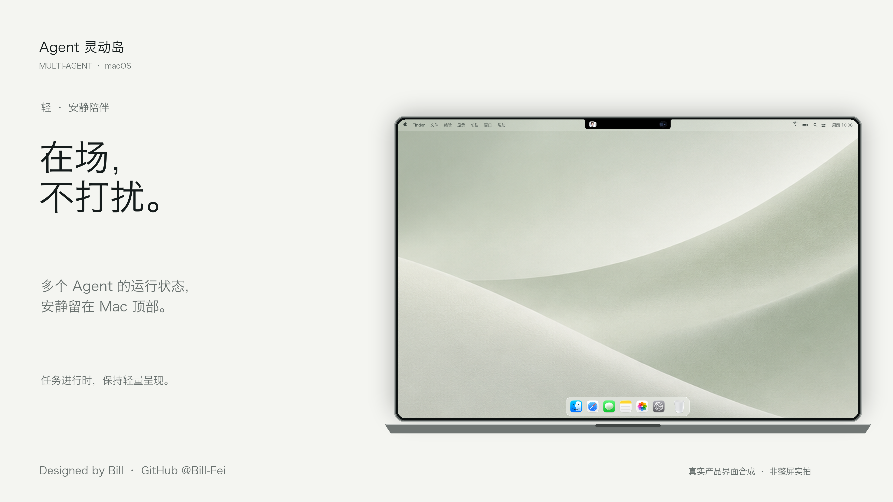
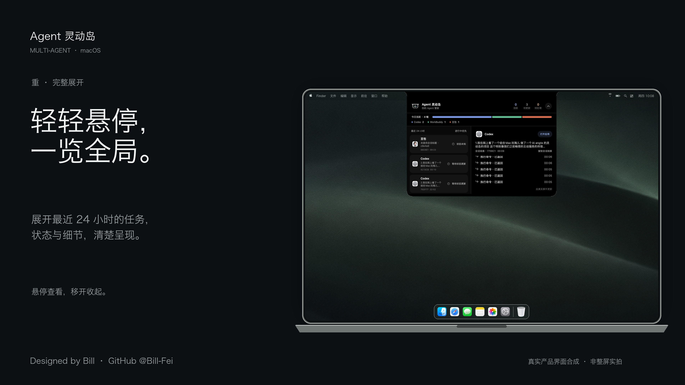
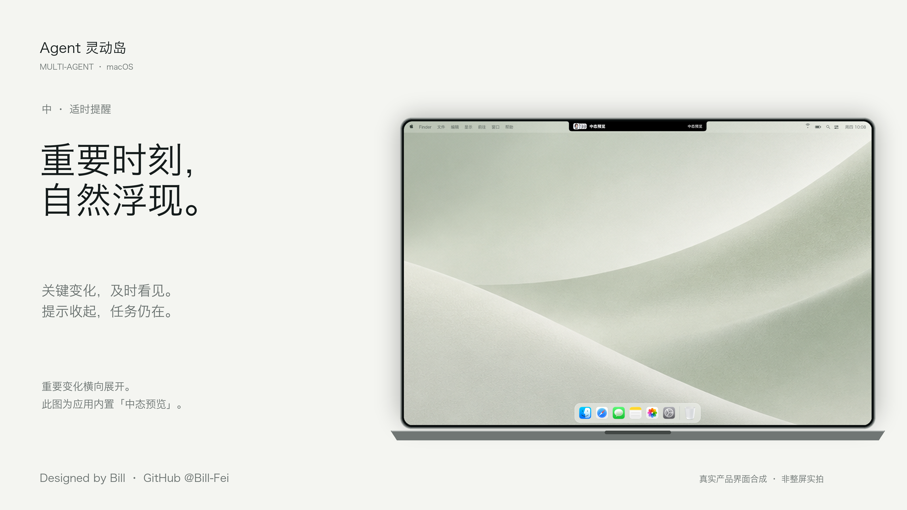
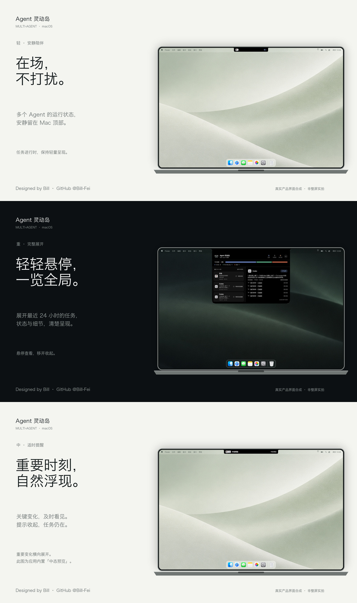
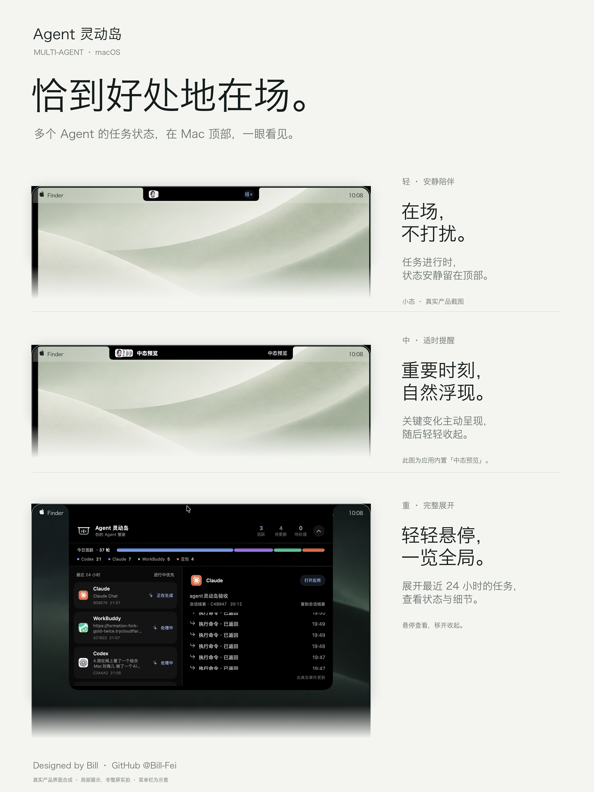

# Agent 灵动岛 · 产品介绍海报

2026-10-08 v6：三张加入 macOS 风格 Dock，分别以 3840 × 2160 重新合成。保留黑色展开态居中、菜单栏、轻 / 中 / 重文案与作者署名。

屏幕以 14 英寸 MacBook Pro 的 3024 × 1964 比例为基准，完整呈现横向屏幕和下方机身。三种岛态使用同一屏幕缩放比例，不单独放大岛的尺寸。设备为示意外框，不是实物照片。

这些是**真实产品界面与展示背景的合成海报**，不是 Mac 整屏实拍。界面仅裁剪、等比缩放和移除窗口外围白底，未重画厂商图标、状态或步骤。中态为应用内置「中态预览」，不代表任务事件；任务总览是截取当时的数据，不代表实时进度。

菜单栏与 Dock 为按系统尺度排版的桌面环境示意，时间、电池等不代表本机实时状态。Apple 字形使用本机系统字体；中央区域留空以避让真实岛态。Dock 使用从本机系统应用读取的原始图标，托盘为模糊半透明合成，不是实时 Dock 截图。不加入桌面文件或其他窗口。

## 轻 · 安静陪伴

在场，不打扰。

## 重 · 完整展开

轻轻悬停，一览全局。

## 中 · 适时提醒

重要时刻，自然浮现。

## 朋友圈分享

长图为 1080 × 1824，仅用于预览；三张单图均为 3840 × 2160，分别保存无损 PNG / 高质量 JPG。画面顺序为轻 / 重 / 中，让黑色展开态居中；状态含义仍按轻 / 中 / 重定义。

4K 文件在 3840 × 2160 画布上从源素材重新合成；文字、设备轮廓和菜单栏重新渲染，不是放大旧海报。产品界面来自原始截图并缩小放入屏幕，未 AI 重画。壁纸沿用原有素材，其细节受源图分辨率限制；4K 画布不意味着原始素材全部具有原生 4K 细节。

署名：Designed by Bill · GitHub @Bill-Fei。GitHub 用户名已通过账号资料确认；链接为 https://github.com/Bill-Fei，不暗示仓库已经上线。

## 产品总览

这张总览海报借鉴「顶部主张 + 三行能力说明」的叙事方式：轻态、中态、展开态分别对应一段真实产品界面局部。尺寸为 2880 × 3840（长边 4K），另有 JPG 和 1080 × 1440 预览图。三种状态不会被误解为同时出现在同一块屏幕；展开态使用更大展示面积。

总览 v2 的展开态来自 Bill 提供的 2026-10-08 21:07:09 原始截图，裁出完整岛体并去掉外围桌面。顶部统计栏包含 Codex、Claude、WorkBuddy、豆包四家；任务列表在该截图中可见 Claude、WorkBuddy、Codex，不补造豆包任务卡片，不修改状态或计数。只保存裁切面板，未将整张私人桌面复制进项目。原始总览版本保留。

分享文案沿用 `media/alpha-covers-20261008-v4/SHARE.md`。单图排版源文件：`media/alpha-covers-20261008-v6-4k/compose_covers.py`；总览排版源文件：`media/alpha-overview-20261008-v2/compose_overview.py`。系统图标保存在单图目录 `assets/`，仅作为桌面环境插图，权利归各自所有者。背景沿用旧版素材中不包含界面的壁纸区域。旧版保留供对比，未作为本版产品界面使用。

本版只在本地生成与保存，未推送 GitHub。
