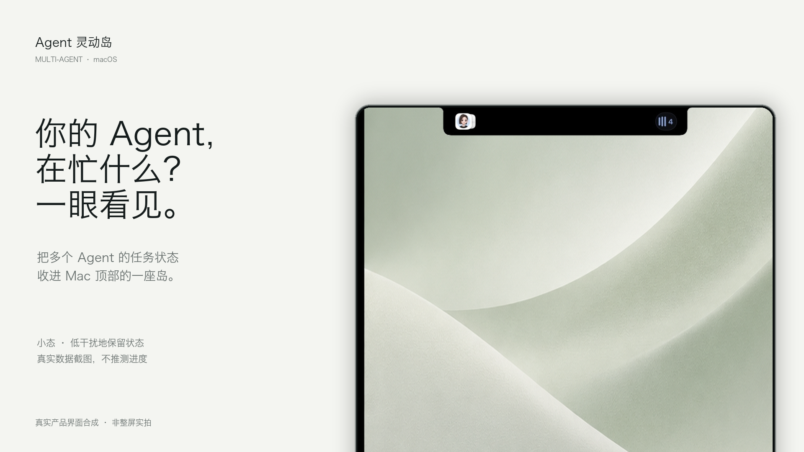
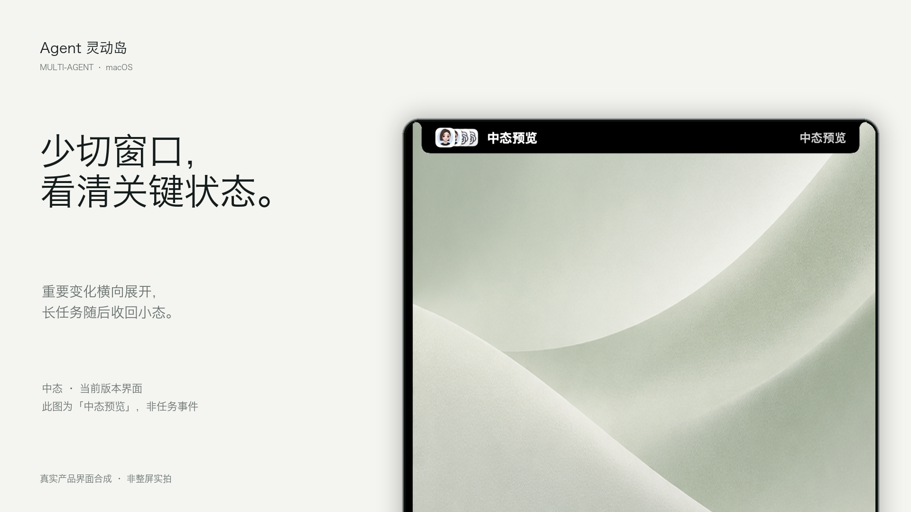
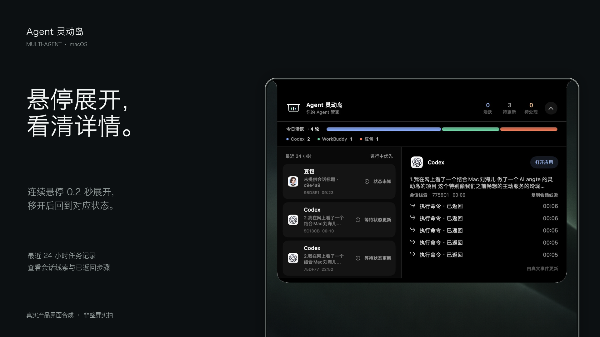

# Agent 灵动岛 · 产品介绍海报

2026-10-08 v2：用真实产品截图替换旧版概念界面，保留浅色 / 深色视觉方向。

这些是**真实产品界面与展示背景的合成海报**，不是 Mac 整屏实拍。界面仅裁剪、等比缩放和移除窗口外围白底，未重画厂商图标、状态或步骤。中态为应用内置「中态预览」，不代表任务事件；任务总览是截取当时的数据，不代表实时进度。

## 小态

## 中态

## Hover 展开态

图片尺寸均为 1920 × 1080。排版源文件：`media/alpha-covers-20261008-v2/compose_covers.py`。背景沿用旧版素材中不包含界面的壁纸区域。旧版保留供对比，未作为本版产品界面使用。

本版只在本地生成与保存，未推送 GitHub。
