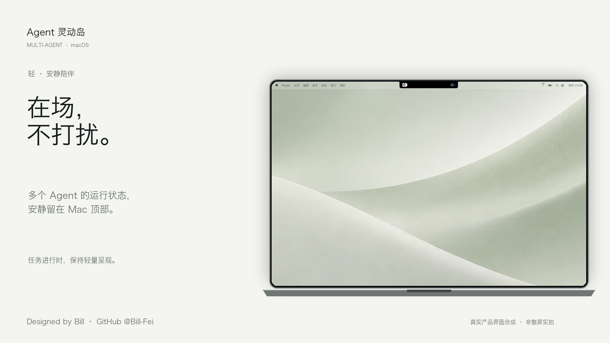
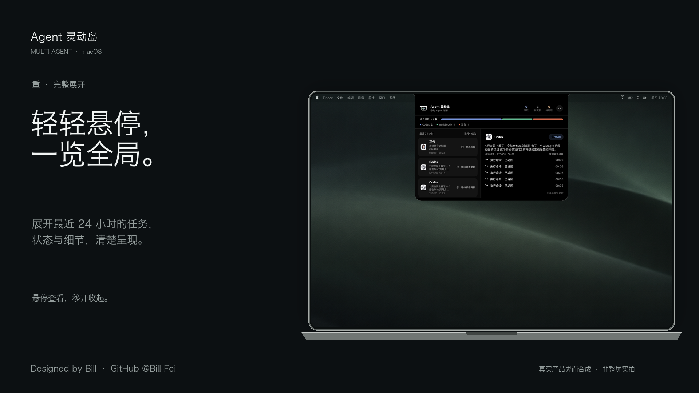
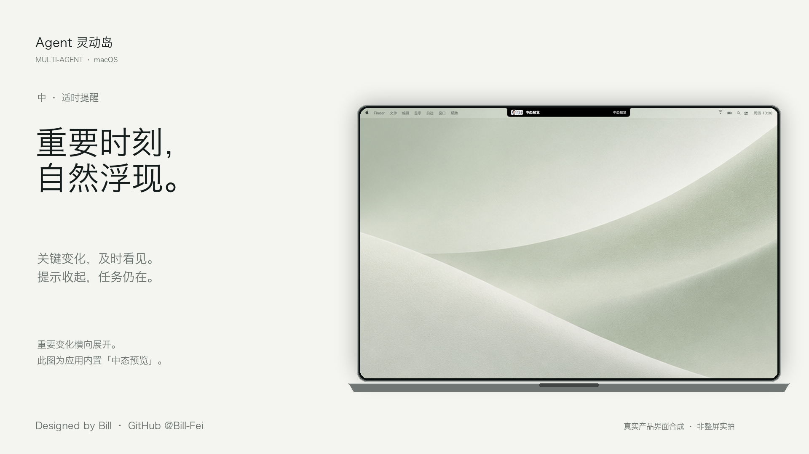
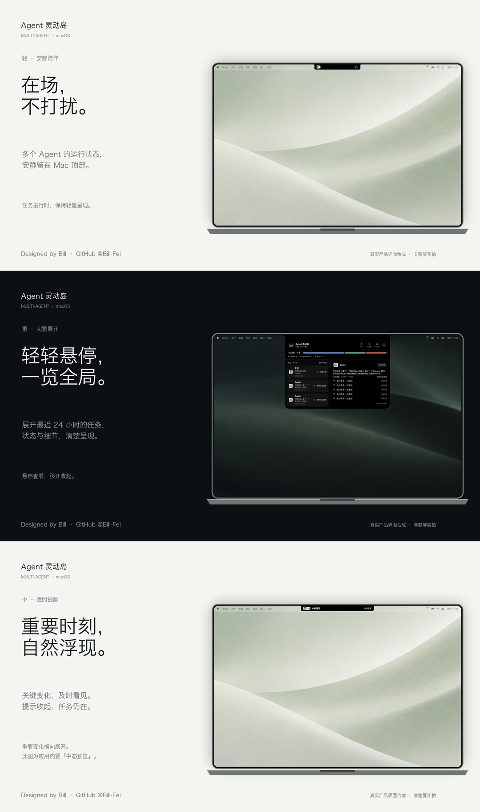

# Agent 灵动岛 · 产品介绍海报

2026-10-08 v5：三张统一加入低存在感的 macOS 菜单栏，保留黑色展开态居中、轻 / 中 / 重文案、作者署名和朋友圈长图。

屏幕以 14 英寸 MacBook Pro 的 3024 × 1964 比例为基准，完整呈现横向屏幕和下方机身。三种岛态使用同一屏幕缩放比例，不单独放大岛的尺寸。设备为示意外框，不是实物照片。

这些是**真实产品界面与展示背景的合成海报**，不是 Mac 整屏实拍。界面仅裁剪、等比缩放和移除窗口外围白底，未重画厂商图标、状态或步骤。中态为应用内置「中态预览」，不代表任务事件；任务总览是截取当时的数据，不代表实时进度。

菜单栏为按系统尺度排版的桌面环境示意，时间、电池等不代表本机实时状态。Apple 字形使用本机系统字体；中央区域留空以避让真实岛态。菜单栏随浅色 / 深色壁纸切换文字色，不加入 Dock、桌面文件或其他窗口。

## 轻 · 安静陪伴

在场，不打扰。

## 重 · 完整展开

轻轻悬停，一览全局。

## 中 · 适时提醒

重要时刻，自然浮现。

## 朋友圈分享

长图为 1080 × 1824；三张单图均为 1920 × 1080，并提供 PNG / JPG。画面顺序为轻 / 重 / 中，让黑色展开态居中；状态含义仍按轻 / 中 / 重定义。

署名：Designed by Bill · GitHub @Bill-Fei。GitHub 用户名已通过账号资料确认；链接为 https://github.com/Bill-Fei，不暗示仓库已经上线。

分享文案沿用 `media/alpha-covers-20261008-v4/SHARE.md`。排版源文件：`media/alpha-covers-20261008-v5/compose_covers.py`。背景沿用旧版素材中不包含界面的壁纸区域。旧版保留供对比，未作为本版产品界面使用。

本版只在本地生成与保存，未推送 GitHub。
